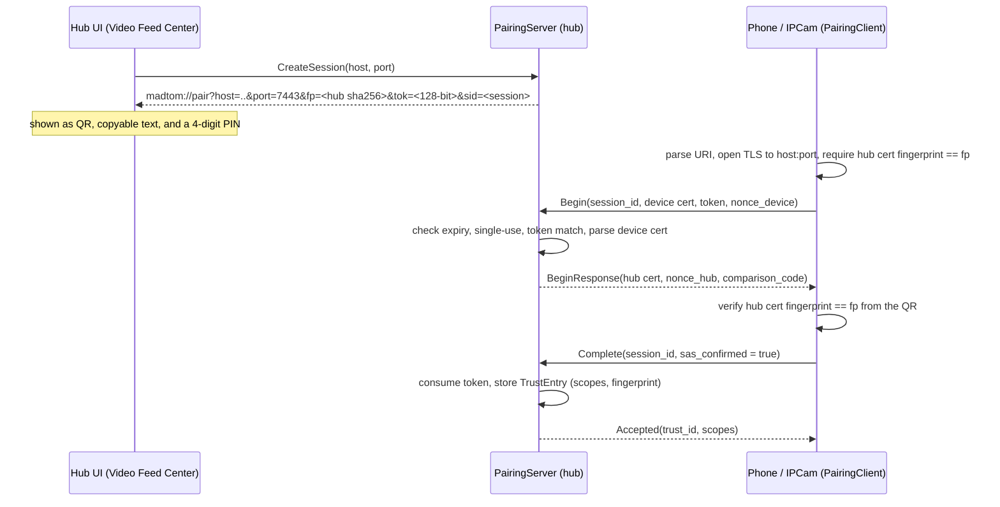

# Foundation: Pairing and Trust

> How a phone (or any device) becomes trusted by the MADTOM hub: identity certificates, the QR and manual-PIN pairing flows, the trust store, and an honest account of what is and is not enforced today.

Related: [Protocols and Local IPC](protocols-and-ipc.md), [IPCam pairing and UI](../Plugins/IPCam/pairing-and-ui.md), [Video Feed Center UI](../Plugins/VideoFeedCenter/ui-and-viewer.md).

Code: `MADTOM_DOTNET/src/Core/MADTOM.Identity` (`DeviceCertificate`, `TrustStore`, `PairingServer`, `PairingClient`, `PairingUtils`), proto `proto/madtom/pairing/v1/pairing.proto`.

---

## 1. Model

There is no MADTOM Account server in this slice. Trust is local and peer to peer:

- Every device and the hub has one **identity**: a self-signed ECDSA P-256 X.509 certificate valid for 10 years, created on first run (`DeviceCertificate.GenerateSelfSigned`). Its identity is the SHA-256 fingerprint of the certificate, lower-case hex.
- The hub keeps a **trust store** (`trust_store.json`) of paired device fingerprints with granted scopes.
- Trust evaluation sits behind `ITrustProvider`, so a future Account-issued trust source can replace `TrustStore` without touching callers.

### 1.1 Files on disk

| What | Linux | Windows | Android |
|---|---|---|---|
| Hub certificate (`hub_cert.pfx`) | `~/.local/share/madtom/` | `%LOCALAPPDATA%\MADTOM\` | n/a |
| Trust store (`trust_store.json`) | `~/.local/share/madtom/` | `%LOCALAPPDATA%\MADTOM\` | n/a |
| IPCam device certificate (`device.pfx`) | `~/.local/share/MADTOM/ipcam/` | `%LOCALAPPDATA%\MADTOM\ipcam\` | `<app files dir>/ipcam/` |

> [!WARNING]
> `.pfx` files are written with **no password** and default file permissions. Anyone who can read the hub's `hub_cert.pfx` can impersonate the hub to a device that pinned it. Keep that directory private to your user.

### 1.2 Scopes

`PairingServer.Complete` grants a fixed set today: `video.source.publish`, `video.feed.view`, `video.feed.control`. `TrustStore.IsTrusted(fingerprint, scope)` checks the entry exists and contains the scope.

### 1.3 Trust store behaviour

- In-memory `ConcurrentDictionary` keyed by fingerprint, loaded from JSON at startup, saved atomically (write `.tmp`, then rename) under a semaphore after every change.
- `RevokeTrustAsync(trustId)` removes the entry and persists. There is no UI for revocation yet.
- `UpdateLastSeen` updates memory only; it does not persist, so `lastSeenAtUtc` on disk is the pairing time until the next save.
- A corrupt JSON file is silently ignored and the store starts empty.

---

## 2. QR pairing (primary path)

The hub shows a QR code; the phone scans it or pastes the URI.

Properties:

- **Hub pinning.** The QR carries the hub certificate fingerprint. `PairingClient.CreateSecureChannel(host, port, pinnedFingerprint, clientCert)` rejects any TLS server certificate whose SHA-256 differs, so a LAN attacker cannot substitute their own certificate. `PairWithQrAsync` additionally re-checks the certificate returned in `BeginResponse`.
- **Token.** 128 random bits, hex. Single use (`IsTokenConsumed`), 5 minute lifetime from session creation. The proto field `valid_duration_seconds` in `GetPairingQrRequest` is currently ignored; the lifetime is fixed at 5 minutes.
- **Host in the URI.** `PairingUtils.GetLocalLanIpAddress()` picks the address of the interface that would route to the internet (a UDP "connect" to 8.8.8.8 sends nothing), then falls back to the first non-loopback IPv4. It used to be `127.0.0.1`, which made the phone dial itself.

---

## 3. Manual PIN pairing (fallback)

For devices that cannot scan a QR. Both screens derive a 4-digit comparison code from `SHA256(hubCert || deviceCert || nonceHub || nonceDevice)` (first 4 bytes, big-endian, modulo 10000). If the numbers match, nobody sits in the middle. The user confirms on the phone; a mismatch makes `Complete(sas_confirmed=false)` abort and discard the session.

> [!WARNING]
> **The manual path is not usable end to end today.** Two problems, both found by reading the code:
>
> 1. `PairingServer.CreateSession` stores a *random* 4-digit code on the session and the hub UI shows that. When the phone calls `Begin`, the server overwrites it with the real derived code, but the hub dialog never refreshes. The number on the hub can therefore not match the number the phone derives.
> 2. The IPCam manual flow invents its own session ID (`Guid.NewGuid()[..8]`). The server only knows IDs it created via `CreateSession`, so `Begin` returns `NotFound`.
>
> The QR path (including pasting the `madtom://` URI) does not have these problems. Fixing the manual path means (a) the UI polling the session for the derived code after `Begin`, and (b) the hub displaying the session ID for the phone to enter.

---

## 4. Threat model: intended versus enforced

| Threat | Intended defence | Actually enforced today? |
|---|---|---|
| LAN attacker swaps the hub during QR pairing | Hub fingerprint pinned from the QR | Yes |
| Stolen or replayed QR token | Single use, 5 minute expiry | Yes |
| Unpaired device opens a source session (spec AT3) | Mutual TLS: reject unknown client certificate at the TLS layer | **No**, see 4.1 |
| Unauthenticated host uses the UI control API over TCP | Local-only UI API | **No**, see 4.2 |
| Plaintext media on the wire | SRT with a per-session passphrase | Only for the SRT/OBS path; IPCam media is not SRT yet |
| Revoked device keeps streaming | Deleting the trust entry denies the next connection | Partly: only checked if a client certificate is presented, which it is not (4.1) |

### 4.1 Client certificates are never requested

`FeedEngineHost` configures Kestrel with `UseHttps(hubCertificate)` and no `ClientCertificateMode`. The default is "do not ask for a client certificate". `VideoSourceControlService.Session` reads `HttpContext.Connection.ClientCertificate`, which is therefore always `null`, and the trust check is written as "if a certificate is present, verify it" so it is skipped. The device-side code does attach its certificate, and the hub certificate pin on the device side works, but the hub does not authenticate the device. Any host that can reach TCP 7443 can open a source session and create a feed.

Fix: set `HttpsConnectionAdapterOptions.ClientCertificateMode = RequireCertificate` (plus a validation callback that accepts self-signed certificates) for the TCP endpoint, and reject sessions without a trusted certificate. Pairing itself must remain reachable without a client certificate, so it needs its own port or an endpoint-level exception.

### 4.2 The UI API is also on TCP 7443

`FeedEngineHost` maps `VideoFeedIpcService`, `VideoSourceControlService` and `PairingServer` on the same Kestrel host, and that host listens on both the Unix socket and `0.0.0.0:7443`. Nothing restricts `VideoFeedIpcService` to the Unix socket. A LAN client can call `GetPairingQr` (and then pair itself), `CreateFeed`, `RemoveFeed`, or stream `WatchPreview`.

Until fixed, treat port 7443 as trusted-LAN only and firewall it from untrusted networks. Fix: `RequireHost`/`RequireAuthorization` per endpoint, or two separate Kestrel hosts.

### 4.3 Other notes

- SRT passphrases appear on the `ffmpeg` command line (visible to local users in `ps`) and in the Video Feed Center inspector.
- Expired pairing sessions are only removed when someone calls `Begin` on them, so unused sessions stay in memory until process exit.
- IPCam, once paired, pins the hub fingerprint for the control channel. Before pairing it accepts any hub certificate (needed for first contact).

---

## 5. Tests

`MadTOM.Tests/Core/IdentityAndPairingTests.cs` covers: certificate generation and fingerprint, trust store persistence and scope checks, comparison-code determinism, the QR path succeeding and a second use being rejected, and the manual path aborting on a mismatch. These test `PairingServer`/`PairingClient` logic directly; none of them test the TLS layer, so they cannot catch the gaps in section 4.
