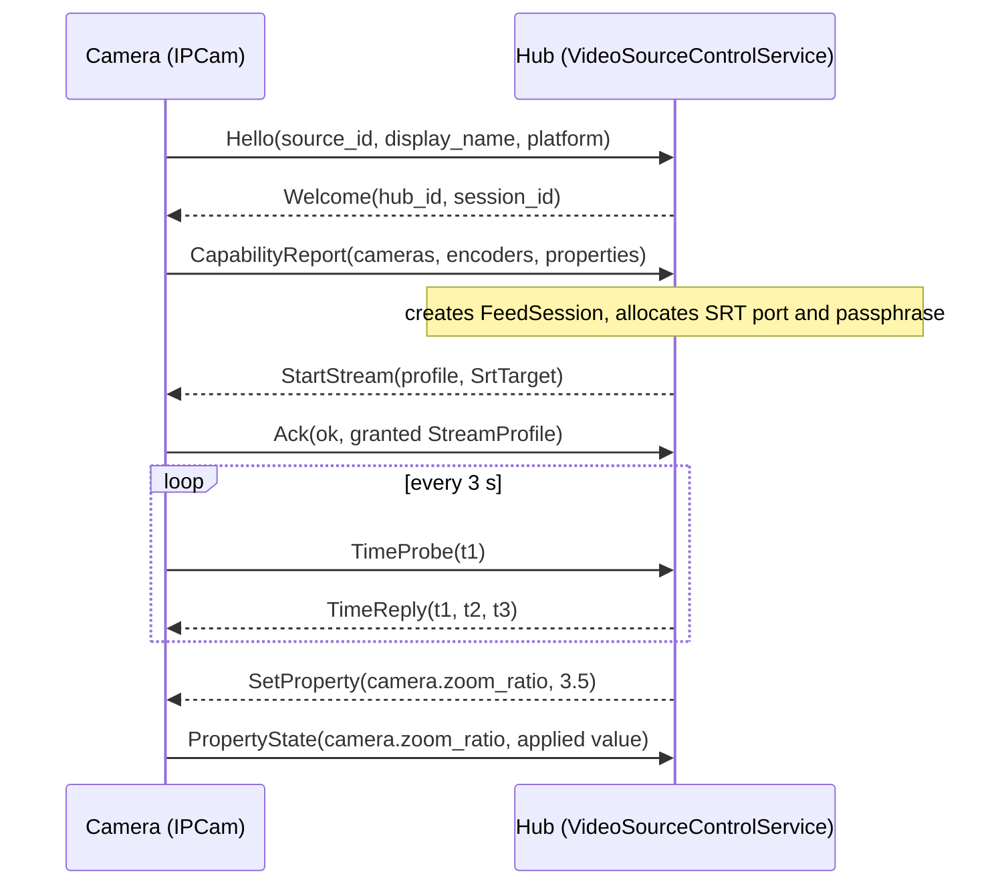

# Foundation: Protocols and Local IPC

> Reference for the shared libraries underneath [Video Feed Center](../Plugins/VideoFeedCenter/README.md) and [IPCam](../Plugins/IPCam/README.md): the `.proto` contracts, the generated code, the local IPC transports (Unix sockets and named pipes) and the file-based capability registry.

These libraries are plugin-independent on purpose. The goal in the [Slice 0 spec](../../planning/10-09-implementation-phase1/MADTOM%20Slice%200%20Spec%20Foundation,%20IPCam%20and%20Video%20Feed%20Center.md) is that later plugins (compositor, storage, automation) reuse them instead of inventing their own IPC.

Related: [Pairing and Trust](pairing-and-trust.md).

---

## 1. Where the code lives

| Project | Path | Hand-written lines | Role |
|---|---|---|---|
| `proto/` | `proto/madtom/<area>/v1/*.proto` | 375 | Source of truth for every wire contract |
| `MADTOM.Protocol` | `MADTOM_DOTNET/src/Core/MADTOM.Protocol` | 0 (generated) | C# messages and gRPC stubs, built from `proto/` by `Grpc.Tools` |
| `MADTOM.Ipc` | `MADTOM_DOTNET/src/Core/MADTOM.Ipc` | 400 | Socket/pipe paths, gRPC channel factory, manifest publish/scan |
| `MADTOM.Identity` | `MADTOM_DOTNET/src/Core/MADTOM.Identity` | 691 | Device certificates, trust store, pairing client and server |
| `MADTOM.Media.Contracts` | `MADTOM_DOTNET/src/Core/MADTOM.Media.Contracts` | 388 | MPEG-TS muxer, asset manifest, clock sync maths |
| Go stubs | `MADTOM_GOLANG/pkg/protocol` | 0 (generated) | Same contracts for the Go collector side |

### Why the plugins look like "10 thousand lines" for a small UI

Most of the volume is not hand-written. Measured on this repo:

| Bucket | Lines | Notes |
|---|---|---|
| Generated C# protobuf/gRPC | about 14,800 | Regenerated into `MADTOM.Protocol/obj/<config>/proto/...` on every build. `VideoSource.cs` (6,548) and `VideoFeed.cs` (5,221) dominate |
| Generated Go protobuf/gRPC | about 4,600 | `MADTOM_GOLANG/pkg/protocol/**` |
| Hand-written C# (all of Video Feed Center, IPCam and the shared cores) | 5,877 | Breakdown below |
| AXAML | 864 | IPCam 447, Video Feed Center 356, the two standalone shells 61 |
| Unit tests | 835 | Core 367, IPCam 340, Video Feed Center 128 |
| `.proto` source | 375 | The only thing you edit to change a contract |

Hand-written C# by project:

| Project | Lines |
|---|---|
| `MADTOM.Plugins.IPCam` (engine abstraction, simulated engine, session client, view model, config) | 1,445 |
| `MADTOM.Feed.Engine` (feed manager, sessions, both gRPC services, host) | 1,143 |
| `MADTOM.Plugins.IPCam.Android` (Camera2 engine, activity, foreground service) | 809 |
| `MADTOM.Plugins.VideoFeedCenter` (view model, feed item, module) | 757 |
| `MADTOM.Identity` | 691 |
| `MADTOM.Ipc` | 400 |
| `MADTOM.Media.Contracts` | 388 |
| Standalone shells (`.App` projects) and `MADTOM.Feed.Daemon` | 244 |

So the honest answer to "why so many lines for a UI that does little" is: about 70 percent of the total is generated protocol code, and most of the remaining hand-written code is plumbing (identity, IPC, muxer, session state) rather than screens. The UI is deliberately thin. See [Implementation status](#5-implementation-status) for what the plumbing does not yet do.

---

## 2. The protocol contracts

All packages are `madtom.<area>.v1`. Inside a version only additive changes are allowed. A breaking change would ship as `v2` served side by side.

| File | Package | Services | Purpose |
|---|---|---|---|
| `core/v1/capabilities.proto` | `madtom.core.v1` | none | `ProcessManifest`, `EndpointDescriptor`, `CapabilityDescriptor` used by the registry |
| `pairing/v1/pairing.proto` | `madtom.pairing.v1` | `Pairing` (`Begin`, `Complete`) | Device-to-hub trust establishment |
| `video/v1/video_source.proto` | `madtom.video.v1` | `VideoSourceControl` (`Session`) | Bidirectional control stream a camera opens to the hub |
| `video/v1/video_feed.proto` | `madtom.video.v1` | `VideoFeedService` (9 RPCs) | What a UI uses to list feeds, watch previews, create OBS listeners, request a QR |

### 2.1 `VideoSourceControl.Session` (camera to hub)

One long-lived bidirectional stream. The camera dials out and the hub sends commands back down the same stream, so the camera needs no inbound port and survives IP changes.



Message bodies are `oneof`s. Source-to-hub: `Hello`, `CapabilityReport`, `Ack`, `Stats`, `PropertyState`, `TimeProbe`. Hub-to-source: `Welcome`, `StartStream`, `StopStream`, `SetProperty`, `TimeReply`.

Notes that matter when reading the code:

- `StreamProfile` carries `camera_id`, `codec` (`hevc` or `avc`), size, fps, `bitrate_bps`, `rate_control`, `idr_interval_ms`, and a free-form `extra` map reserved for codec-specific keys.
- `Property` is the seed of a general control model. Today only `camera.zoom_ratio` exists. The hub sends `SetProperty`; the source replies with the value it actually applied in `PropertyState` (clamped and stepped), which is the "requested versus applied" contract.
- `Stats` is defined in the proto but nothing sends or consumes it yet.
- `StopStream` is defined and handled by the camera but the hub never sends it today.

### 2.2 `VideoFeedService` (UI to engine)

| RPC | Kind | What it does |
|---|---|---|
| `ListFeeds` | unary | Snapshot of all `FeedInfo` |
| `GetFeed` | unary | One feed, `NotFound` if unknown |
| `WatchFeeds` | server stream | Snapshot as `ADDED` events, then live `ADDED/UPDATED/REMOVED` |
| `WatchPreview` | server stream | Raw `PreviewFrame` messages (BGRA32) for one feed |
| `CreateFeed` | unary | Creates an unauthenticated SRT listener (the OBS path) |
| `RemoveFeed` | unary | Disposes a feed |
| `SetFeedProperty` | unary | Forwards a property change to the source via the stored setter |
| `GetPairingQr` | unary | Creates a pairing session and returns the `madtom://pair` URI and PIN |
| `RecordLatencyTick` | unary | Computes the latency figures shown in the latency card |

`FeedState` values: `WAITING`, `LIVE`, `STALLED`, `RECONNECTING`, `STOPPED`. `RECONNECTING` exists in the enum but nothing sets it yet.

### 2.3 Regenerating code

- C#: automatic. `MADTOM.Protocol.csproj` has `<Protobuf Include="../../../../proto/madtom/<area>/v1/*.proto" ProtoRoot="../../../../" GrpcServices="Both" />` entries, so a normal `dotnet build` regenerates the stubs.
- Go: generated stubs live in `MADTOM_GOLANG/pkg/protocol`. Regenerate with `protoc` and the Go plugins whenever a `.proto` changes. There is no repo script for this yet.

Never edit generated files by hand.

---

## 3. Local IPC

The engine and its UI talk gRPC over a local socket, not over TCP, so an unprivileged local client needs no certificates and nothing is exposed to the network.

### 3.1 Paths (`MADTOM.Ipc/IpcPaths.cs`)

| Platform | Socket / pipe | Manifest directory |
|---|---|---|
| Linux/macOS with `$XDG_RUNTIME_DIR` | `$XDG_RUNTIME_DIR/madtom/<id>.sock` | `$XDG_RUNTIME_DIR/madtom/manifests/` |
| Linux/macOS without it | `<tmp>/madtom-<uid>/<id>.sock` | `<tmp>/madtom-<uid>/manifests/` |
| Windows | `\\.\pipe\madtom-<id>` | `%LOCALAPPDATA%\MADTOM\run\` |

For the video engine `<id>` is always `feedd`.

> [!NOTE]
> The older line in `cli-and-scripts.md` that said `/tmp/madtom-feedd.sock` was wrong and has been corrected. The socket is under `$XDG_RUNTIME_DIR/madtom/` when that variable is set.

> [!IMPORTANT]
> The code does not `chmod` the socket. The "same user only" property relies on `$XDG_RUNTIME_DIR` being mode `0700`. On the `<tmp>/madtom-<uid>` fallback the directory is created with default permissions, so treat that fallback as less protected.

### 3.2 Channel factory (`IpcChannelFactory`)

`CreateChannel(EndpointDescriptor)` picks the transport from `endpoint.Transport`:

| Transport | How the channel is built |
|---|---|
| `uds` | `SocketsHttpHandler.ConnectCallback` opens an `AddressFamily.Unix` socket |
| `pipe` | `ConnectCallback` opens a `NamedPipeClientStream` |
| anything else | plain `GrpcChannel.ForAddress(http://host:port)` |

`CreatePlatformLocalChannel(id)` resolves the right path for the current OS and calls the matching builder. gRPC channels are lazy, so creating one never fails; errors show up on the first call.

### 3.3 The capability registry (`ProcessManifest`, `ProcessRegistry`)

There is no central broker. Each process publishes a JSON manifest to the manifest directory and removes it on clean exit:

```json
{
  "id": "feedd",
  "version": "0.1.0",
  "pid": 4182,
  "endpoints": [
    { "transport": "uds",       "address": "/run/user/1000/madtom/feedd.sock", "enabled": true },
    { "transport": "tcp-mtls",  "address": "0.0.0.0:7443",                     "enabled": true }
  ],
  "provides": [
    { "capability": "madtom.video.feed.v1",           "version": "1.0" },
    { "capability": "madtom.video.source-control.v1", "version": "1.0" },
    { "capability": "madtom.pairing.v1",              "version": "1.0" }
  ]
}
```

- `ManifestManager.PublishAsync` writes `<id>.json.tmp` then renames it, so readers never see a half-written file.
- `ProcessRegistry.FindProvider(capabilityId)` scans the directory, drops manifests whose PID is dead (`CleanStaleManifests` deletes them), and returns the first enabled endpoint that provides the capability.
- `WatchProviders(capability, callback)` uses a `FileSystemWatcher` with a 50 ms debounce to report providers appearing and disappearing.
- Consumers ask for a capability, never for a plugin name. Video Feed Center phase 1 always owns its embedded engine and uses loopback TCP (see [Engine and Daemon](../Plugins/VideoFeedCenter/engine-and-daemon.md#4-daemon-versus-embedded-engine)).

Stale-PID detection means a crashed daemon stops being advertised on the next scan. It does not remove a stale `.sock` file. `FeedEngineHost.StartAsync` deletes an existing socket file before binding.

---

## 4. Media contracts

### 4.1 `MpegTsMuxer`

A small MPEG-TS packetizer, used by IPCam to wrap encoder output. For each access unit it:

1. On the first frame and every keyframe, emits one PAT packet (PID `0x0000`) and one PMT packet (PID `0x0100`). The PMT stream type is `0x1B` for H.264 or `0x24` for HEVC.
2. Builds a PES header with a 33-bit PTS (90 kHz clock) and splits PES plus NAL data into 188-byte packets on PID `0x0101`.
3. Puts a PCR (equal to the PTS) and, on keyframes, the random-access indicator in the adaptation field of the first packet; pads the last packet with adaptation-field stuffing.
4. Maintains per-PID continuity counters.

It is covered by `MpegTsMuxerTests` (exact 188-byte packets, sync bytes, fragmentation of large frames). It is **not** validated against a real decoder in the test suite.

### 4.2 `AssetManifest` (`madtom.asset/1`)

JSON sidecar describing a recording: feed ID, device trust ID, start/end, clock info, requested versus granted profile, and a list of renditions (`original`, `proxy`). `VerifyRenditionOverlap(tolerance)` checks that all renditions start and end within a tolerance of the first one (the spec's AT6 uses 3 seconds). `ClockSyncCalculator.Calculate(t1,t2,t3,t4)` is the standard four-timestamp offset and RTT formula.

---

## 5. Implementation status

Verified by reading the code, not by running hardware:

| Area | Status |
|---|---|
| Proto contracts and generation | Complete for Slice 0 |
| Manifest publish, stale-PID cleanup | Implemented and unit tested (`IpcTests`) |
| UDS / named-pipe gRPC channels (`IpcChannelFactory`) | Implemented and used by the Video Feed Center plugin at runtime; no direct unit test |
| `Stats` message | Defined; nothing sends or consumes it |
| `StopStream` message | Defined and handled by IPCam; the hub never sends it |
| `RECONNECTING` feed state | Defined; nothing sets it |
| Socket file permissions | Not set explicitly |
| Go consumers of these protocols | Stubs are generated; no Go code outside `pkg/protocol` imports them yet |
